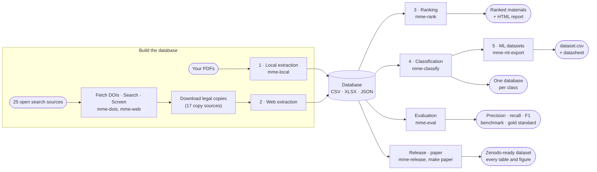
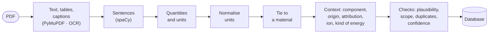

# MoukhlijMatExtract (MME)

> Extract · Rank · Classify: battery-materials data from the scientific literature, for solid electrolytes,
> cathodes and anodes, with the source of every value.

[](https://github.com/YounesMoukhlij/MoukhlijMatExtract/actions/workflows/tests.yml)
[](https://pypi.org/project/moukhlijmatextract/)
[](https://pypi.org/project/moukhlijmatextract/)
[](#platforms-and-tests)
[](LICENSE)

**Website:** [moukhlijmatextract.vercel.app](https://moukhlijmatextract.vercel.app) (how to use the program, step
by step) · **Manual:** [docs/MANUAL.md](https://github.com/YounesMoukhlij/MoukhlijMatExtract/blob/main/docs/MANUAL.md)
· **Every option:** [docs/COMMANDS.md](https://github.com/YounesMoukhlij/MoukhlijMatExtract/blob/main/docs/COMMANDS.md)
· **Limitations:** [docs/LIMITATIONS.md](https://github.com/YounesMoukhlij/MoukhlijMatExtract/blob/main/docs/LIMITATIONS.md)

---

## Contents

1. [The project in one minute](#the-project-in-one-minute)
2. [Why it exists](#why-it-exists)
3. [What a value looks like](#what-a-value-looks-like)
4. [How it works](#how-it-works)
5. [Inside the extraction](#inside-the-extraction)
6. [Where the papers come from](#where-the-papers-come-from)
7. [Ranking, classification and ML datasets](#ranking-classification-and-ml-datasets)
8. [How accurate it is](#how-accurate-it-is)
9. [Reproducibility and open data](#reproducibility-and-open-data)
10. [The program](#the-program)
11. [Install](#install)
12. [Quick start](#quick-start)
13. [Where your files go](#where-your-files-go)
14. [Repository layout](#repository-layout)
15. [Platforms and tests](#platforms-and-tests)
16. [Documentation](#documentation)
17. [Author, citation and license](#author-citation-and-license)

---

## The project in one minute

**MoukhlijMatExtract (MME)** is an open-source research tool. It reads scientific papers about battery materials
and builds a **structured, traceable database of their ion-transport data**. Then it **ranks** the materials,
**classifies** them by structure, and **exports datasets** for machine learning.

| | |
|---|---|
| **Domains** | solid-state **electrolytes**, **cathodes**, **anodes**: each with its own search, database and ranking criteria |
| **Quantities** | activation energy · ionic conductivity · electronic conductivity · diffusion coefficient, in common units. Electrode jobs also extract capacity, retention, voltage and rate capability |
| **Context of each value** | material (formula and parsed composition), temperature, pressure, transport component (bulk / grain boundary / total / surface), measured or computed, the paper's own result or a cited one, mobile ion, kind of energy |
| **Provenance** | paper, page, section, sentence, table row and column, or figure caption, for **every** value |
| **Inputs** | your own PDFs, and/or papers found on the web from **25 search sources** and downloaded from **17 legal copy sources** |
| **Outputs** | CSV, Excel and JSON databases; per-component rankings with an HTML report; one database per structure class; ML-ready datasets; a release folder ready for Zenodo |
| **Quality control** | `needs_check` and `confidence` on every value, plausibility ranges, duplicate detection, a Verify tab for checking by hand, and a full evaluation suite (precision, recall, F1, benchmark, gold standard) |
| **Interfaces** | a desktop application (Tkinter) with a window per part, and ten terminal commands with the same options |
| **Platforms** | macOS, Linux and Windows, Python 3.11 to 3.13, tested on each by continuous integration |
| **License** | GNU AGPL-3.0-or-later |

---

## Why it exists

Thousands of papers report how fast ions move through battery materials. Each paper does it in its own words, units
and table layout:

- *"E_a = 0.28 eV"* in a table;
- *"an activation energy of 27 kJ mol⁻¹"* in a sentence;
- *"σ_bulk of 1.38 × 10⁻³ S cm⁻¹ at 23.5 °C"* in a caption.

Comparing materials across that literature by hand takes weeks. The result is rarely traceable to the sentence it
came from.

MME automates that work and keeps it checkable:

- every number is converted to one unit and tied to its material;
- every number is labelled with what it measures;
- every number links back to where it was printed.

It reads nothing it may not read: only your own PDFs and legally available copies.

---

## What a value looks like

One row of `activation_energy.csv`, as MME extracts it from one of the two open-access papers of the worked example
([examples/](examples/README.md); fields abridged):

| Field | Value |
|---|---|
| `material_formula` | Li6.25La3Zr2Fe0.25O12 |
| `activation_energy_eV` | 0.28 |
| `energy_kind` | arrhenius |
| `transport_component` | bulk |
| `data_origin` / `attribution` | experimental / this work |
| `mobile_ion` | Li+ |
| `temperature` | 296.6 K |
| `structure` | garnet |
| `composition` | {"Li": 6.25, "La": 3.0, "Zr": 2.0, "Fe": 0.25, "O": 12.0} |
| `source` | Table 3, row: 0.25 · column: E a (eV) |
| `page` / `section` | 7 / Results |
| `sentence` | *Table 3. Li-Ion Conductivity σbulk and Activation Energy Ea at 23.5 °C for Li7−3xFexLa3Zr2O12 (x = 0.18 and x = 0.25)* |
| `material_link` | table_row: the formula was resolved from the series Li7−3xFexLa3Zr2O12 with x = 0.25 |
| `basis` | for every answer, whether it was stated or assumed, and why (here: temperature from the table, pressure assumed) |
| `confidence` / `needs_check` | 0.99 / no |

Every column of every table is described in
[docs/DATA_DICTIONARY.md](https://github.com/YounesMoukhlij/MoukhlijMatExtract/blob/main/docs/DATA_DICTIONARY.md).
Each database also carries the dictionary as `data_dictionary.csv` and as a sheet of `database.xlsx`.

---

## How it works

Two parts build the database; the others read it.



| # | Part | Command | Reads | Writes |
|---|---|---|---|---|
| 1 | **Local extraction** | `mme-local` | your PDFs | a database: one CSV per quantity, `database.xlsx`, `database.json` |
| 2 | **Web scraping** | `mme-dois`, `mme-web` | the keywords of a job file | the legal copies of the papers it finds, and a database of the same form |
| 3 | **Ranking** | `mme-rank` | one or more databases | materials ranked by activation energy, per transport component, and an HTML report |
| 4 | **Classification** | `mme-classify` | one or more databases | one database per crystal-structure type, per structure family, and per property branch |
| 5 | **ML datasets** | `mme-ml-export` | a class of part 4, or a database | `dataset.csv` (one row per material), every value behind it, a datasheet |
| — | **Evaluation** | `mme-eval` | a database and a person's checks | precision, recall and F1 with intervals; recall against curated databases; benchmark; gold standard |
| — | **Release** | `mme-release` | every result | one license-checked folder and `.zip`, with datasheet and checksums |

Every part runs from its own window or from the terminal. A part never redoes finished work: it skips a PDF already
extracted, a search run in the last 30 days, or a ranking whose inputs did not change. Each part has a switch to redo
it (`--rebuild`, `--refresh`, `--force`). MME never deletes your input PDFs.

Each part also has its own README with every detail: [LocalExtraction](LocalExtraction/README.md),
[WebScraping](WebScraping/README.md), [SelectingTopMaterial](SelectingTopMaterial/README.md),
[Classification](Classification/README.md), [Evaluation](Evaluation/README.md).

---

## Inside the extraction

The extraction (`LocalExtraction/`) is a rule-based pipeline: no language model is asked to guess. It is shared by
parts 1 and 2:



- **Reading the PDF.** Text, tables (ruled tables, and the unruled ones most journals print, found under their
  "Table N" caption), captions and equations are read with PyMuPDF. Scanned pages are read with Tesseract OCR. A
  damaged or non-PDF file is reported, never entered empty.
- **Quantities and units.** The program recognises:
  - energies in eV, meV, kJ/mol and kcal/mol;
  - conductivities in S/cm, S/m and inverse ohms;
  - diffusion coefficients in cm²/s and m²/s.

  It also handles publisher symbol fonts, lost multiplication signs, and multi-line table headers.
- **Materials.** Formulas are parsed into compositions, including:
  - composition series (`Li6+xP1−xGexS5I` with the x the paper gives);
  - mixtures (`(100−x)(0.75Li2S·0.25P2S5)·xLiBH4`);
  - fractional subscripts;
  - doped samples named after their parent ("Ta-LLZO", "Ga-doped LLZO" → `Ta-doped Li7La3Zr2O12`), kept as their
    own material rather than given to the parent compound.

  A material named only in a role that is never the sample (an electrode, a reagent, a filler) takes no value.
- **Context.** These come from the paper's words and table headers; when a field is assumed, the `basis` column says
  so:
  - the transport component, from headers like E_a,bulk or σ_gb;
  - measured or computed, and the paper's own result or a cited one;
  - the mobile ion (Li⁺, Na⁺, K⁺, Mg²⁺, …, Cs⁺, Rb⁺);
  - the kind of energy: an Arrhenius slope, an NEB migration barrier, a bond-valence barrier, local NMR hops, a VTF
    pseudo-activation energy, or no ion migration.
- **Checks.**
  - `plausibility` flags values outside the range known for ion conductors.
  - `scope.py` flags materials of another domain (an electrode in an electrolyte database).
  - An Arrhenius cross-check compares Ea with the conductivities.
  - `duplicates.py` traces a value repeated or quoted by a later paper back to its original.
  - `needs_check` says, with the reasons, which values a person should look at.

Every run records the language model used (`extracted_with` in `papers.csv`). MME prefers scispaCy's
`en_core_sci_sm`, then `en_core_web_sm`, then a plain sentence splitter.

---

## Where the papers come from

**Legal sources only.** Every service is used through the interface it offers to programs. The web part:

- respects `robots.txt` (RFC 9309) and `Crawl-delay`;
- spaces requests per host and backs off on "too many requests";
- never bypasses a paywall, a login, a bot check or a refusal;
- does not use shadow libraries (Sci-Hub, LibGen …), and they cannot be added.

Papers with no legal copy are listed, to get through your library or from the authors.

**The whole literature in one command.** `mme-web update --all --yes` (`make update ALL=1 YES=1`) runs every job file
in turn, the ones never run included: one per domain and one per family of solid electrolytes.

| Stage | What happens |
|---|---|
| **1 · Fetch DOIs** | collects the DOIs of the topic from the job's keywords |
| **2 · Search** | asks every source each keyword, and OpenAlex's **full-text index** for every paper whose full text holds the data words (`"activation energy" "ionic conductivity"`: about 22,000 works); merges the same paper found by several sources by its DOI; fills missing abstracts; optionally follows citations (snowballing) |
| **Screen** | scores each paper on topic and property words (a full-text match counts as the property words). Learns from your keep / reject decisions. Leaves the candidates for you to review |
| **3 · Download** | tries each copy source in turn and records where each PDF came from (`source_service`, `download_log.csv`). arXiv PDFs come first from arXiv's public bulk copy, with no pause between files |
| **4 · Extract** | the same extraction as part 1, into the web database |

- **Search sources (25):**
  - without a key (16): OpenAlex, arXiv, Crossref, Semantic Scholar, Europe PMC, OpenAIRE, DOAJ, J-STAGE, PLOS,
    NASA NTRS, Zenodo, DataCite, Figshare, OSF Preprints, LA Referencia, theses.fr;
  - with a key (9): CORE, Springer Nature, Scopus, NASA ADS, IEEE Xplore, Web of Science, The Lens, BASE,
    Dimensions.
- **Copy sources (17):**
  - the publishers' interfaces for programs: Elsevier and Wiley (open access, and your institution's subscription
    on its network), APS, and the text-mining links publishers register with Crossref;
  - open-access links: OpenAlex, Unpaywall, and the open-access publisher's own page;
  - repositories: arXiv, PubMed Central, OSTI, HAL, Zenodo, DataCite, Semantic Scholar, NASA ADS, OpenAIRE, CORE.

Most API keys are free and all are optional: without any key the open sources still work. Each job file
(`configs/*.yaml`) sets the domain, the searches, the sources, the years and the screening. One job ships per domain,
plus one per family of solid electrolytes (garnet, NASICON, argyrodite, LGPS, halide, …).

---

## Ranking, classification and ML datasets

**Ranking** (`SelectingTopMaterial/`). Bulk, grain-boundary and total activation energies are different quantities,
so each component is ranked on its own and never mixed. Each material gets one activation energy per component: by
default, the confidence-weighted median of its values. It also gets a class from
[`criteria.toml`](SelectingTopMaterial/criteria.toml):

| Electrolytes | Ea | | Cathodes and anodes | Ea |
|---|---|---|---|---|
| **Superionic** | < 0.25 eV | | **Low barrier** | < 0.30 eV |
| **Performant** | 0.25 – 0.30 eV | | **Moderate barrier** | 0.30 – 0.50 eV |
| **Acceptable** | 0.30 – 0.40 eV | | **High barrier** | > 0.50 eV |
| **Rejected** | ≥ 0.40 eV | | | |

You can filter the ranking:
- by element, origin, attribution, kind of energy, confidence or phase;
- by policy: the median, the lowest or the highest value of each material.

Each rank says how sure it is: the number of values and papers, the spread, and how much of it was assumed.
Materials Project entries can be shown beside each composition. The electrode limits are starting points to set for
your study, not literature criteria.

**Classification** (`Classification/`). Each material is classified twice:
- by **crystal-structure type**: NASICON, LISICON, thio-LISICON, garnet, argyrodite, LGPS, perovskite,
  antiperovskite, spinel, olivine, layered, …;
- by **structure family**: oxide, sulfide, halide, oxyhalide, nitride, hydride, ….

Each class is a database of the same form as the input, so one class can be ranked alone. **Classify everything**
then splits each family into a tree of datasets: family → property → component → origin. Each branch gets a
`dataset.csv` and a `values.csv`.

**ML datasets** (`MLDataset/`). A family, a property, a component, an origin and your filters produce a folder with:
- `dataset.csv`: one row per material, with the median, log10 for conductivities, the spread, the counts and a group
  column for grouped splits;
- `values.csv`: every value behind each row, with its sentence and page;
- `excluded.csv`: every value left out, and why;
- a datasheet, and the settings to make it again.

Values marked wrong in the Verify tab are left out. Repeated measurements are counted once.

---

## How accurate it is

MME is measured, and the measurements are published with their limits. Read
[docs/LIMITATIONS.md](https://github.com/YounesMoukhlij/MoukhlijMatExtract/blob/main/docs/LIMITATIONS.md) before
relying on the data.

**Recall against curated databases** (`mme-eval reference`). The ionic conductivities of two curated lithium
solid-electrolyte databases, looked for in the same papers (legal open copies only). Version 1.1.0, 2026-11-08:

| Database | Papers | Entries | Material found | Material and value (0.1 decade) |
|---|---:|---:|---:|---:|
| OBELiX (Therrien et al., 2025) | 27 | 64 | 35.9 % | 12.5 % |
| Liverpool Ionics Dataset (Hargreaves et al., 2023) | 11 | 48 | 50.0 % | 6.2 % |

Recall is low for four reasons:
- About 40 % of the curated entries exist only in figures. The curators read them off Arrhenius plots; MME reads text,
  tables and captions.
- Compositions are named otherwise (analysed versus nominal formula, "Al-doped LLZO").
- Some PDF tables lose their layout.
- The sample is small: only 38 papers had a legal open copy to read.

**Precision on hand-annotated papers** (an independent audit, activation energies, two rounds of 40 random papers,
95 % Wilson intervals):

| Round | Values | Fully correct | Correct if the doubtful cases are right |
|---|---:|---:|---:|
| F | 76 | 37 % (27–48 %) | 62 % (51–72 %) |
| G (after fixing what F showed) | 82 | 41 % (31–52 %) | 57 % (47–67 %) |

"Fully correct" is strict. The number, the material, the origin, the attribution, the component, the kind of energy
and the domain must all be right. **The number itself is read correctly about 95 % of the time** (an earlier round of 80 values). Most errors are in
*what it is a value of*: a doped sample stored under its parent formula, a composite stored as its ceramic, or another
member of a series. **The values behind a publication should therefore be checked by a person.** MME is built for
that:
- `needs_check` lists the values worth a look;
- the **Verify tab** marks each value right, wrong or corrected, and those marks carry into the ML datasets;
- `mme-eval` measures the result.

**The evaluation suite** (`Evaluation/`, protocol in
[docs/EVALUATION_PROTOCOL.md](https://github.com/YounesMoukhlij/MoukhlijMatExtract/blob/main/docs/EVALUATION_PROTOCOL.md)):

| Command | Does |
|---|---|
| `mme-eval sheet` | draws papers at random into an annotation workbook, with a guide (correct / partly / wrong, values missed) |
| `mme-eval score` | precision, recall and F1 per property and overall, with 95 % bootstrap intervals, at two levels (right value; right value *for the right material*), plus calibration of `confidence` and an error analysis |
| `mme-eval agree` | agreement of two annotators (Cohen's κ) |
| `mme-eval reference` | recall against OBELiX and the Liverpool Ionics Dataset |
| `mme-eval benchmark` | MME against a keyword baseline and any other tool (ChemDataExtractor, an LLM prompt …), on the same papers, with paired differences |
| `mme-eval gold` | the annotated papers as a public gold-standard dataset (CC BY 4.0), ready for Zenodo |

---

## Reproducibility and open data

- **Exact environment.**
  - `requirements.lock` pins every package version (`make install-locked`).
  - A **Dockerfile** pins the same environment, with Tesseract.
- **How each result was made.** Every run appends to `run_manifest.json` in its results folder:
  - the command and settings;
  - the version and git commit;
  - the language model, Tesseract, Python and package versions;
  - the counts, and the rows and SHA-256 of every file written.
- **The article, made again from the data.** `make paper` (or `make paper-docker`) rebuilds every table and figure
  into `~/MoukhlijMatExtract/paper/`, with fixed seeds:
  - the database summary and the duplicates;
  - the figures;
  - the ranking and the classification;
  - the scores and the benchmark.

  `environment.json` records the commit, the package versions, the lock hash and the input checksums.
- **The dataset, ready to deposit.** `mme-release` writes one folder and one `.zip`. It holds:
  - every value and bibliographic field;
  - the text quoted from papers, only where their license allows (CC BY, CC0, public domain);
  - the data dictionary, the run manifests and the lock file;
  - a datasheet and `SHA256SUMS`.

  Papers without a record of a legal source are left out and listed in `excluded.csv`. Zenodo gives the archive a
  DOI.
- **A worked example.** `make demo` takes two CC BY papers through extraction, ranking and classification, offline,
  in about a minute. A test checks that the values stay the same.

---

## The program

`mme-gui` opens the main window: one card per part, each with **Open**, **Results…** and **Delete outputs…**. Every
window shares the same design:

- **Progress you can trust.** Each long step does the following:
  - it says at the start how long it will take, from this computer's earlier runs;
  - it shows a progress bar and a dark-yellow line with what it is doing, "N of M", and the time left;
  - it says what is already saved if you stop now;
  - **⏱ Progress details** follows the phases, the pace and a timeline of what was searched or fetched.
- **Pause, Resume, Stop.** A stopped step goes on from where it stopped next time. It waits for the internet when the
  connection drops, and keeps the computer awake during long runs.
- **Results card.** Each step ends with ✓ / ⚠ / ✕ / ○, the time taken, the key numbers and findings, and buttons for
  the next step.
- **Verify tab.** Check values by hand next to their sentence and page, with filters for the values flagged.
- **Results… / Browse the CSV files…** Every table of a part, sortable and searchable, even with hundreds of thousands
  of rows. A row opens its paper at doi.org.
- **Guides built in:**
  - **⚠ Requirements**;
  - **☰ Manual**: every command with every option;
  - **⚙ Make commands**: every `make` target explained, with a diagram of the project flow;
  - **⇄ Flow**: a floating button that shows the whole process from scratch, with "You are here";
  - **About & methods**.
- **Comfort.**
  - Light and dark mode; windows that fit any screen, down to 1024 × 768.
  - One copy of each window; "‹ Back to the main window".
  - Delete outputs to the Trash.
  - On macOS, an optional Dock icon.

The terminal gives the same parts with the same options:

| Command | Does |
|---|---|
| `mme` | every command in one: `mme help`, `mme commands`, `mme <part> …` |
| `mme-gui` | the main window |
| `mme-local` | 1 · extract your PDFs |
| `mme-dois`, `mme-web` | 2 · fetch DOIs; search, download and extract |
| `mme-rank` | 3 · rank by activation energy |
| `mme-classify` | 4 · classify by structure and property |
| `mme-ml-export` | 5 · a dataset for machine learning |
| `mme-eval` | measure the accuracy |
| `mme-release` | the dataset, ready to deposit |

`mme-local`, `mme-web`, `mme-rank`, `mme-classify` and `mme-ml-export` open their own window with `gui` (for example
`mme-rank gui`). Add `--help` to any command for its options. From the source code, `make help` lists every `make` shortcut.

---

## Install

**What you need:**

| | Why | How |
|---|---|---|
| **Python 3.11+** | runs MME | [python.org](https://www.python.org/downloads/) |
| **Tesseract OCR** | reads scanned PDFs | macOS `brew install tesseract` · Ubuntu `sudo apt install tesseract-ocr` · Windows [installer](https://github.com/UB-Mannheim/tesseract/wiki) |
| **Tk** | draws the windows; the terminal commands work without it | included with python.org · Homebrew `brew install python-tk@3.13` · Ubuntu `sudo apt install python3-tk` |

**As a user, from PyPI:**

```bash
python3 -m venv .venv && source .venv/bin/activate   # Windows: .venv\Scripts\activate
pip install moukhlijmatextract
python -m spacy download en_core_web_sm              # the English language model, once
mme-gui
```

**As a developer, from the source:**

```bash
git clone https://github.com/YounesMoukhlij/MoukhlijMatExtract.git
cd MoukhlijMatExtract
make install          # venv, packages, the mme-* commands and the language model (macOS, Linux)
make gui
```

On Windows, run the steps of `make install` by hand: `pip install -r requirements.txt`, then `pip install -e .`, then
the spaCy model.

**For an exact reproduction:** `make install-locked`, or the Docker image (`make paper-docker`).

---

## Quick start

```bash
make demo                 # two example papers → extraction, ranking, classification (examples/output/)
mme-gui                   # or open the main window and follow the cards 1 → 5
```

From the terminal, a whole study:

```bash
mme-local                                   # 1 · your PDFs in ~/MoukhlijMatExtract/LocalExtraction/papers/
mme-web run --check                         # 2 · test the network, keys and folders
mme-web                                     #     search, download and extract (configs/sse.yaml)
mme-rank --open                             # 3 · rank, and open the HTML report
mme-classify                                # 4 · classify
mme-ml-export --family garnet --target Ea --component bulk --origin experimental   # 5 · an ML dataset
mme-eval sheet && mme-eval score            # measure the accuracy (after annotating the workbook)
mme-release                                 # the dataset, ready for Zenodo
```

Cathodes and anodes use their own job file and database, for example
`mme-web run --job configs/cathode.yaml --output WebScraping/web_output_cathode`, then
`mme-rank --domain cathode --source …`.

Every step, every option and every output is in
[docs/MANUAL.md](https://github.com/YounesMoukhlij/MoukhlijMatExtract/blob/main/docs/MANUAL.md).

---

## Where your files go

Every part works inside **`~/MoukhlijMatExtract`**, whatever folder it starts from. The main window offers to create
it on first start; **Restore the job files** brings back a missing one without touching your edits.

```
~/MoukhlijMatExtract/
├── configs/                      job files of the web search (yours to edit)
├── docs/                         the manual, commands, data dictionary, limitations
├── .env                          your API keys
├── LocalExtraction/papers/       ← put your own PDFs here
├── LocalExtraction/local_output/ database of part 1
├── WebScraping/papers/           PDFs downloaded by part 2, with the record of their source
├── WebScraping/web_output/       database of part 2
├── SelectingTopMaterial/results/ the ranking: bulk/, grain_boundary/, total/, summary.csv
├── Classification/               crystal_structure/, structure_families/, by_property/
├── Ready for ML/                 the ML datasets
├── Evaluation/                   annotation workbooks, scores, benchmark, gold standard
├── Release/                      the datasets ready to deposit
└── paper/                        every table and figure of the article (make paper)
```

---

## Repository layout

```
MoukhlijMatExtract/
├── LocalExtraction/      part 1 and the shared extraction engine: PDF reading, OCR, tables, quantities, units,
│                         materials, context, plausibility, duplicates, provenance; the shared GUI toolkit (gui/)
├── WebScraping/          part 2: Fetch_DOIs/, and averageScrap/ (search sources, screening, legal download,
│                         ledger, watcher, coverage, its window)
├── SelectingTopMaterial/ part 3: criteria (*.toml), selection, HTML report, Materials Project, window
├── Classification/       part 4: structure types and families, property branches, window
├── MLDataset/            part 5: ML dataset export and its step-by-step window
├── Evaluation/           sheet, score, agree, reference, benchmark, gold
├── Release/              the Zenodo-ready dataset
├── mme_gui/              the main window, manual, make guide, process flow, macOS app
├── configs/              the shipped job files (one per domain and per electrolyte family)
├── docs/                 manual, commands, data dictionary, limitations, evaluation protocol, families
├── examples/             two CC BY papers and their expected values
├── scripts/              reproduce_paper.py, audit tools, icon
├── Dockerfile · Makefile · requirements.lock · pyproject.toml · CITATION.cff · .zenodo.json
└── .github/workflows/    tests on every push; publishing to PyPI
```

---

## Platforms and tests

The test suite has about 940 tests. They cover:
- the extraction rules, on real sentences and tables;
- every source adapter and every shipped job file;
- the ranking, the classification, the ML export, the evaluation and the release;
- every window, which a harness opens, clicks through, and checks for cut-off text and contrast in light and dark
  mode.

GitHub Actions runs the suite on every push:

| System | Python |
|---|---|
| Ubuntu 24.04 | 3.11 · 3.12 · 3.13 (window tests skipped: no screen) |
| Windows | 3.13 |
| macOS | 3.13 |
| A clean environment | the built wheel installed as from PyPI, every command started once |

```bash
make test                 # the whole suite
make test K="stop" FAST=1 # a selection, quickly
```

---

## Documentation

| Document | For |
|---|---|
| [docs/MANUAL.md](https://github.com/YounesMoukhlij/MoukhlijMatExtract/blob/main/docs/MANUAL.md) | the complete manual: install, every step for each domain, the outputs, accuracy, reproducing a result |
| [docs/COMMANDS.md](https://github.com/YounesMoukhlij/MoukhlijMatExtract/blob/main/docs/COMMANDS.md) | every option of every command (generated from the commands) |
| [docs/DATA_DICTIONARY.md](https://github.com/YounesMoukhlij/MoukhlijMatExtract/blob/main/docs/DATA_DICTIONARY.md) | every table and column |
| [docs/LIMITATIONS.md](https://github.com/YounesMoukhlij/MoukhlijMatExtract/blob/main/docs/LIMITATIONS.md) | what MME does not do well, with the measurements |
| [docs/EVALUATION_PROTOCOL.md](https://github.com/YounesMoukhlij/MoukhlijMatExtract/blob/main/docs/EVALUATION_PROTOCOL.md) | the held-out evaluation, written before the draw |
| [docs/FAMILIES.md](https://github.com/YounesMoukhlij/MoukhlijMatExtract/blob/main/docs/FAMILIES.md) | the families of solid electrolytes and their job files |
| [docs/PUBLISHING.md](https://github.com/YounesMoukhlij/MoukhlijMatExtract/blob/main/docs/PUBLISHING.md) | publishing a release |
| [CHANGELOG.md](CHANGELOG.md) · [CONTRIBUTING.md](CONTRIBUTING.md) · [CODE_OF_CONDUCT.md](CODE_OF_CONDUCT.md) | history, how to contribute, community rules |

---

## Author, citation and license

**Younes Moukhlij** is a PhD researcher working on solid-state electrolytes at the Faculté Polydisciplinaire de
Khouribga (FPK), Université Sultan Moulay Slimane (USMS), and a software-engineering student at 1337 Coding School. MME brings the two together: software engineering put to work for materials research. Contact:
[younes.moukhlij@usms.ac.ma](mailto:younes.moukhlij@usms.ac.ma).

**Cite.** If you use MME in your research, please cite it: see [`CITATION.cff`](CITATION.cff), or the **Cite this
repository** button on GitHub.

**License.** Copyright © 2026 Younes Moukhlij.

MoukhlijMatExtract is free software: you can redistribute it and/or modify it under the terms of the
[GNU Affero General Public License](LICENSE), version 3 or (at your option) any later version. It comes WITHOUT ANY
WARRANTY.

The AGPL is required because MME reads PDFs with [PyMuPDF](https://pymupdf.readthedocs.io), which is AGPL-3.0. Every
other dependency is permissive (MIT, BSD, Apache-2.0).

The license covers the software, not the data it extracts. What a released dataset may hold, and under which terms,
is set out in its own README (see `mme-release`).
