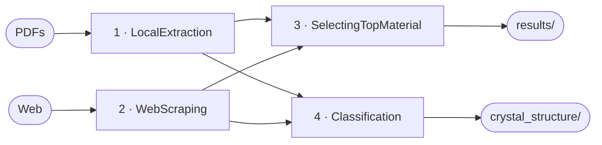

# MoukhlijMatExtract (MME)

> Extract · Rank · Classify solid-state electrolyte data from scientific literature.

[](LICENSE)
[](https://pypi.org/project/moukhlijmatextract/)
[](https://pypi.org/project/moukhlijmatextract/)

MME reads scientific papers on **solid-state electrolytes**, extracts their activation energies,
conductivities and other properties into structured databases, then **ranks** and **classifies**
the materials by crystal family.



## Install

Requires **Python 3.11+** and [Tesseract OCR](https://github.com/tesseract-ocr/tesseract) — a system binary that must be installed separately:

```bash
brew install tesseract                        # macOS
sudo apt install tesseract-ocr python3-tk     # Ubuntu / Debian
# Windows: https://github.com/UB-Mannheim/tesseract/wiki
```

Then install the package and the spaCy language model:

```bash
pip install moukhlijmatextract
python -m spacy download en_core_web_sm
```

Web scraping method 2 (requires Google Chrome):
```bash
pip install "moukhlijmatextract[scrape]"
```

## Quick Start

```bash
mme-gui          # open the full GUI hub — one button per part
mme-local        # 1 · extract your local PDFs
mme-web          # 2 · scrape the web and extract
mme-rank         # 3 · rank materials by activation energy
mme-classify     # 4 · classify by crystal and structure family
```

Run the parts left to right, or launch everything from `mme-gui`.

## The Four Parts

| # | Part | Input | Output |
|---|------|-------|--------|
| 1 | **LocalExtraction** | PDFs in `LocalExtraction/papers/` | `local_output/` — one CSV per quantity + `database.xlsx` |
| 2 | **WebScraping** | Job config `configs/sse.yaml` | `web_output/` — same structure as part 1 |
| 3 | **SelectingTopMaterial** | Both outputs above | `results/` — ranked by activation energy, HTML report |
| 4 | **Classification** | Ranked materials | `crystal_structure/` + `structure_families/` |

Each part has its own README with full details. Parts 1 and 2 build the database independently; parts 3 and 4 consume both.

## WebScraping: Two Methods, One Database

Both methods write to `WebScraping/papers/` and `WebScraping/web_output/`.

**Method 1 — open-source search** (default `mme-web`): queries OpenAlex, arXiv, Crossref, Semantic Scholar and 10 more services. Free API keys are optional — set them from the GUI's **API keys** panel.

**Method 2 — moukhlij4scraping**: collect DOIs, fetch a PDF per DOI, then extract.
```bash
mme-dois --count 500                  # collect DOIs into dois.txt
# then use the GUI or mme-web --stage extract
```

## Keeping It Up to Date

| After… | Run |
|--------|-----|
| Adding PDFs to `LocalExtraction/papers/` | parts 1 → 3 → 4 |
| Wanting more web papers | parts 2 → 3 → 4 |
| Changing ranking limits in `criteria.toml` | part 3 |
| Updating the code | parts 1 / 2 with `--rebuild`, then 3 and 4 |

## Cite

See [`CITATION.cff`](CITATION.cff) — GitHub shows a **Cite this repository** button on the repo page.

## License

MIT © 2026 Younes Moukhlij
