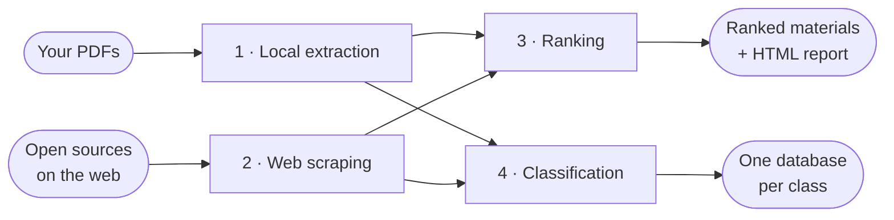

# MoukhlijMatExtract (MME)

> Extract · Rank · Classify — solid-state electrolyte data from the scientific literature.

[](LICENSE)
[](https://pypi.org/project/moukhlijmatextract/)
[](https://pypi.org/project/moukhlijmatextract/)

## About the project

**MoukhlijMatExtract (MME)** is an open-source research tool for mining the scientific literature on
**solid-state electrolytes**. Thousands of papers report how fast ions move through a solid — but each in
its own words, units and table layout, so comparing materials across the literature by hand takes weeks.
MME does that work automatically and keeps it traceable.

It reads papers — your own PDFs, or articles it finds and retrieves online from open sources — and
extracts their **ion-transport data** into a structured database:

- **activation energies**, **ionic and electronic conductivities** and **diffusion coefficients**,
  converted to common units;
- the **material** each value belongs to, the temperature, the measurement or simulation method, and
  whether the value is the paper's own result or one it cites;
- the **source of every value** — paper, page, table, figure or sentence — so any number can be checked.

The materials are then **ranked by activation energy** (Superionic, Performant, Acceptable, Rejected)
and **classified** by crystal-structure type (NASICON, garnet, argyrodite, LGPS, perovskite, …) and by
structure family (oxide, sulfide, halide, …), to support the data-driven screening of candidate
electrolytes.

MME works from a window (no command line needed) or from the terminal, keeps all your files in one
folder, never redoes work already done, and never deletes your input PDFs.

### How it works

MME has four parts. Parts 1 and 2 build the database; parts 3 and 4 read it.



| # | Part | Reads | Writes |
|---|------|-------|--------|
| 1 | **Local extraction** (`mme-local`) | your PDFs | a database: one CSV per quantity, `database.xlsx`, `database.json` |
| 2 | **Web scraping** (`mme-web`) | keywords of a job file | the legal open-access copies of the papers it finds, and a database of the same form as part 1 |
| 3 | **Ranking** (`mme-rank`) | the databases of parts 1 and 2 | the materials ranked by activation energy, and an HTML report |
| 4 | **Classification** (`mme-classify`) | the databases of parts 1 and 2 | one database per crystal-structure type and per structure family |

Each part has its own README with every detail: [LocalExtraction](LocalExtraction/README.md),
[WebScraping](WebScraping/README.md), [SelectingTopMaterial](SelectingTopMaterial/README.md),
[Classification](Classification/README.md).

---

## Installation

### What you need first

| Requirement | Why | How to get it |
|-------------|-----|---------------|
| **Python 3.11 or newer** | runs MME | [python.org](https://www.python.org/downloads/) |
| **Tesseract OCR** | reads scanned or image-only PDFs | macOS: `brew install tesseract` · Ubuntu/Debian: `sudo apt install tesseract-ocr python3-tk` · Windows: [installer](https://github.com/UB-Mannheim/tesseract/wiki) |

### Option A — from PyPI

```bash
python3 -m venv .venv                     # create a virtual environment
source .venv/bin/activate                 # enter it (Windows: .venv\Scripts\activate)
pip install moukhlijmatextract            # MME and everything it needs
python -m spacy download en_core_web_sm   # the English language model, once
```

### Option B — from the source code

```bash
git clone https://github.com/YounesMoukhlij/MoukhlijMatExtract.git
cd MoukhlijMatExtract
python3 -m venv .venv                     # one virtual environment for the whole project
source .venv/bin/activate                 # enter it (Windows: .venv\Scripts\activate)
pip install -r requirements.txt           # the packages, inside the venv
pip install -e .                          # the mme-* commands, running this folder's code
python -m spacy download en_core_web_sm   # the English language model, once
```

On macOS and Linux, `make install` does all of this in one step.

Both give the same eight commands — `mme-gui`, `mme-local`, `mme-web`, `mme-dois`, `mme-rank`,
`mme-classify`, `mme-eval`, `mme-release` — with every option (`<command> --help`, or **☰ Manual** in the
main window, which shows them all). The `make` shortcuts come with the source code only: installed from
PyPI, use the commands themselves (the manual shows no make section then).

Work **inside the virtual environment**: in each new terminal, enter it again with
`source .venv/bin/activate` before running MME. Check the installation with:

```bash
mme-gui --version
```

---

## User manual

### Step 0 — Open MME

```bash
mme-gui
```

This opens the main window: one card per part, each with an **Open** button and a
**Delete outputs…** button. The **⚠ Requirements** button at the top opens a short guide to what MME
needs; it turns green (**✓ Requirements**) once you have read it. The **☰ Manual** button beside it lists
every command with all of its options (`mme-local`, `mme-web`, `mme-dois`, `mme-rank`, `mme-classify`, their
`python -m` forms and the `make` shortcuts), with typical runs and a search box. The options are each
command's own `--help`, so the manual always matches the installed program. The bottom of the window
describes the project and its author.

Every part can also be run from the terminal — each step below gives both ways.

#### Where your files go

Every part works inside **`~/MoukhlijMatExtract`** (the folder `MoukhlijMatExtract` in your home
folder), the **main results folder**, whatever folder you start it from. In the main window, press
**Create the main results folder** to make it with every part's folders; once it exists the button reads
**Open the main results folder** and opens it. Opening a part also makes it when it is missing, so the
parts always find each other's files:

```
~/MoukhlijMatExtract/
├── configs/sse.yaml                      ← what the web search looks for (the job file)
├── LocalExtraction/papers/               ← put your own PDFs here
├── LocalExtraction/local_output/         ← database of part 1
├── WebScraping/papers/                   ← PDFs downloaded by part 2
├── WebScraping/web_output/               ← database of part 2
├── SelectingTopMaterial/results/         ← the ranking (part 3)
└── Classification/                       ← the classes (part 4)
    ├── crystal_structure/
    └── structure_families/
```

### Step 1 — Extract your own PDFs

1. Copy your PDFs into `~/MoukhlijMatExtract/LocalExtraction/papers/`.
2. In the main window, open **1 · Local extraction** and press **Start extraction**.
3. Watch the values arrive in the **Activation energies** tab; the **Activity** tab shows the log.

From the terminal:

```bash
mme-local                      # extract the new PDFs of LocalExtraction/papers/
mme-local extract -i ~/Desktop/articles   # another folder of PDFs
mme-local gui                  # the same, in a window
```

| Option | What it does |
|--------|--------------|
| `--input DIR`, `-i` | folder of PDFs (default `LocalExtraction/papers`) |
| `--output DIR`, `-o` | where to write the database (default `LocalExtraction/local_output`) |
| `--workers N`, `-w` | how many PDFs to read at once (default 4) |
| `--offline` | do not complete titles, authors, DOIs and years from OpenAlex |
| `--rebuild` | extract every PDF again (the old database is kept in `previous_<date>/`) |

Only new PDFs are read: a PDF already in the database is reported as `Already extracted … — skipped`.

### Step 2 — Find and extract papers from the web

Open **2 · Web scraping** in the main window. Each time it opens, it asks for your **contact e-mail**
(the open databases ask that callers give one) and points to the API keys. It searches the open sources,
downloads the legal open-access copies into `WebScraping/papers/` and extracts them into
`WebScraping/web_output/`.

**API keys** are all optional — without any key the open sources still work; each key just opens more
papers. They are free, except The Lens (through your institution's subscription, or a non-commercial
trial); Dimensions is free for research on application, and BASE once it has registered your network. Press **API keys…** in the web window: each card has a link to the sign-up page and a
field for the key.

**Closed papers (Elsevier, Wiley).** Their keys download the closed papers your university subscribes to
**only on the university's network** — on campus, or through a VPN that sends everything through it — or,
for Elsevier, from anywhere with the institutional token (`ELSEVIER_INSTTOKEN`, from your library). From
home without either, those papers are not downloaded (the open copies of every paper still are); the
download says so, and tries them again next time. **Check setup** tells you whether the network you are
on is entitled.

#### Customize the search — Search settings…

What the web search looks for is kept in `~/MoukhlijMatExtract/configs/sse.yaml`. Press
**Search settings…** in the Web scraping window to change it in a form instead of editing the file:

| Tab | What you can change |
|-----|---------------------|
| **1 · Searches** | the searches, one per line (`# lines` are headings that group them); a file of papers you already know |
| **2 · Sources and years** | the years; how many results each source gives per search (1–1000); which sources are searched; preprints; where missing abstracts are looked up |
| **3 · Which papers** | the topic, property and excluded words; the minimum score (0–20); whether papers without a free copy are kept |
| **4 · Download** | where a legal copy is looked for; downloads at once (1–8); the largest PDF (1–500 MB) |
| **5 · Data extracted** | which properties are kept (ion transport, every property, or your choice); whether a value must be tied to a material |

Each number is held within its bounds, and nothing is saved while a setting is wrong — the form says
what to fix. A source whose key or e-mail is missing is marked so. The comments and headings of the
file are kept. **Reset to defaults** puts back the settings MME comes with (saved only when you press
**Save**). Some settings are not offered because changing them would break MME: the folder of the PDFs
(always `WebScraping/papers/`) and the job's name. The contact e-mail and the keys are set in
**API keys…**. A window whose step is running lets you open the form once the step is done; a step
already running keeps the settings it started with, and the next one uses the new ones.

#### Search, download, extract

Searches OpenAlex, arXiv, Crossref, Semantic Scholar, Europe PMC and twenty more services by keyword, keeps
the papers on topic, downloads the legal open-access copies and extracts them.

1. Press **2 · Search**. The keywords, years and sources come from the job file
   `~/MoukhlijMatExtract/configs/sse.yaml` — press **Search settings…** to change them.
2. Look through the papers found in the **Candidates** tab.
3. Press **3 · Download** (optionally limit the number of papers; tick *then extract them*).
4. Press **4 · Extract** if you did not let the download extract them.

**Check setup** tests the network, the API keys and the folders. **Pause** holds the running step (what is
under way finishes first) and **Resume** goes on; **Stop** ends it, and the next run goes on where it
stopped. When the internet goes, the step says *No internet connection — waiting for it to come back* and
goes on by itself once it is back.

From the terminal:

```bash
mme-web                        # search, download and extract, as the job file says
mme-web run --check            # test the network, the API keys and the folders
mme-web run --limit 50         # download at most 50 papers in this run
mme-web run --stage extract    # only extract the PDFs already downloaded
mme-web gui                    # the same, in a window
```

| Option | What it does |
|--------|--------------|
| `--job FILE` | another job file (default `configs/sse.yaml`) |
| `--stage discover\|fetch\|extract` | the first stage to run |
| `--yes` | approve every paper found, without a review |
| `--limit N` | download at most N papers in this run |
| `--refresh` | search again the keywords already searched in the last 30 days |
| `--rebuild` | extract every downloaded PDF again |

### Step 3 — Rank the materials

Open **3 · Ranking** and press **Rank**, or from the terminal:

```bash
mme-rank                       # rank everything, write the files
mme-rank --open                # … and open the report in the browser
mme-rank --element Na          # only the sodium conductors
mme-rank --origin experimental --top 20
mme-rank gui                   # the window
```

**Each transport component is ranked on its own — bulk, grain boundary and total.** A bulk Ea and a
total Ea are different quantities, so they are never mixed: each component has its own ranking, its own
ranks and its own classes. In each, a material gets one activation energy (by default the
confidence-weighted median of its values of that component) and a class from
[`criteria.toml`](SelectingTopMaterial/criteria.toml):

| Class | Activation energy |
|-------|-------------------|
| **Superionic** | below 0.25 eV |
| **Performant** | 0.25 – 0.30 eV |
| **Acceptable** | 0.30 – 0.40 eV |
| **Rejected** | 0.40 eV and above |

| Option | What it does |
|--------|--------------|
| `--policy consensus\|optimistic\|conservative` | which value stands for a material: the median, the lowest or the highest |
| `--origin experimental\|simulation` | only measured, or only computed values |
| `--attribution this-work\|cited` | only the papers' own results, or only the values they cite |
| `--element Li Na …` | only materials containing these elements |
| `--component bulk\|grain_boundary\|total` | rank one component only (by default each is ranked) |
| `--min-confidence 0.5` | only values extracted with at least this confidence |
| `--by-phase` | rank the phases of a composition apart (cubic / tetragonal, …) |
| `--top N` | keep the first N materials |
| `--format csv xlsx json html` | which files to write |
| `--source DIR …` | read other databases (for example one class from step 4) |
| `--force` | rank again even if nothing changed |

Each ranking is written into its own folder — `SelectingTopMaterial/results/bulk/`, `grain_boundary/`
and `total/` — each with `top_materials.csv`, `all_materials.csv`, `values.csv`, `selection.xlsx`,
`selection.json` and `report.html`; `results/summary.csv` puts the components side by side. The window
has a tab per component.

### Step 4 — Classify the materials

Open **4 · Classification** and press **Classify**, or from the terminal:

```bash
mme-classify                   # classify, write one database per class
mme-classify gui               # the window
```

Each material is classified twice:

- by **crystal-structure type** — NASICON, LISICON, thio-LISICON, garnet, argyrodite, LGPS, perovskite,
  antiperovskite, spinel, olivine, … → `Classification/crystal_structure/<class>/`
- by **structure family** — oxide, sulfide, halide, oxyhalide, nitride, hydride, … →
  `Classification/structure_families/<class>/`

`Classification/all_materials.csv` lists every material with its two classes. Each class folder is a
database of the same form as parts 1 and 2, so you can rank one class alone:

```bash
mme-rank --source ~/MoukhlijMatExtract/Classification/crystal_structure/garnet
```

### Measuring the accuracy — mme-eval

How accurate is the extracted data? `mme-eval` measures it against values checked by a person, as a
publication needs:

```bash
mme-eval sheet            # 60 papers drawn at random -> Evaluation/annotation.xlsx
#   annotate it: its Guide sheet says how (correct / partly / wrong, and the values missed)
mme-eval score            # -> Evaluation/scores/report.md, metrics.json, errors.csv
mme-eval agree a.xlsx b.xlsx   # two annotators: Cohen's kappa and F1 between them
```

The report gives precision, recall and F1 for each property and overall, with 95 % intervals from
resampling the papers, at two levels: the right value, and the right value for the right material. It
also gives the accuracy of the component and origin, how well the confidence column predicts correctness
(calibration), precision by text and table, and the errors the annotators named. After a change to the
program and a new extraction, `mme-eval score --source LocalExtraction/local_output WebScraping/web_output`
measures the new version against the same reference. Two comparisons complete it: `mme-eval reference`
(recall against the curated OBELiX and Liverpool databases, on their own papers) and other tools scored on
the same annotated papers: any tool's values, as a CSV, go to `mme-eval score --predictions`. See [Evaluation/README.md](Evaluation/README.md); what the program does not
do well, with the numbers, is in [docs/LIMITATIONS.md](docs/LIMITATIONS.md).

### Seeing every result — Results…

Each part in the main window has a **Results…** button (the extraction windows have it too: **Results →
Browse every table…**, or **Browse every table** on the results card). It opens every table of that part
in one window: the list of tables on the left with their number of rows, the chosen table on the right
with every column — sorted by a click on a heading, searched with one box over all its columns — and
every cell of the selected row below, with a button to open the paper at doi.org.

| Part | Its tables |
|------|-----------|
| 1 · Local extraction | papers, activation energies, ionic and electronic conductivities, diffusion coefficients, all properties, materials, methods, values without a material, the papers' tables, figures, equations, workflow, material ↔ value links, summary per paper |
| 2 · Web scraping | the same for the web database, plus the candidates of the search |
| 3 · Ranking | the summary of the components, then for bulk, grain boundary and total: top materials, all materials, values |
| 4 · Classification | every material and its classes, the crystal families and the structure families, each with its Ea by component |

The files are only read: nothing in the window changes them.

### When a step ends — the results card

Every step of every window ends with a **results card** above its tables: ✓ done, ⚠ done with problems
or stopped, ✕ failed, ○ nothing new — with the time it took, big numbers for what it did, the main
findings, and buttons for what comes next.

| Step | The numbers | The findings | Next |
|------|-------------|--------------|------|
| 1 · Local extraction, 2 · Extract (both web methods) | articles read, activation energies, ionic conductivities, materials, PDFs not read | the lowest activation energies and the highest conductivity found, each with its article | show the values, open the workbook or the folder |
| 2 · Search | new papers, proposed, no open copy known | the best matches | review them, download them |
| 3 · Download | downloaded, failed, no copy to be had | the sources the PDFs came from | extract them |
| 3 · Ranking | the materials of each component (bulk, grain boundary, total), how many superionic, the best of each | the best two materials of each component, with their article | show each component, open the report, the folder |
| 4 · Classification | materials, crystal families, structure families, activation energies | the largest crystal families, their lowest Ea and its article | show the classes, open the class folders |

**Every table names its articles.** Each CSV of the databases has the article's `title` right after
`paper_id` (the file name stands for a paper that states no title, and says so); the ranking's and the
classification's tables of materials have `articles`, the titles of the papers their values come from.
A database written before gets the column added the next time
it is opened — nothing is extracted again.

### Running a part again never redoes finished work

Each part says what it skips and moves on to the next item:

| Part | Already done | Message | To redo it |
|------|--------------|---------|------------|
| 1 · Local extraction | a PDF already in the database | `Already extracted: <file> — skipped.` | `--rebuild` |
| 2 · `mme-web` | a search run in the last 30 days, a paper already downloaded | `already searched …` / `Already fetched: <doi> …` | `--refresh` / `--rebuild` |
| 3 · Ranking | the same databases, criteria and options as the last ranking | `Already ranked … — skipped.` | `--force` |
| 4 · Classification | the same databases as the last classification | `Already classified … — skipped.` | `--force` |

### Keeping the results up to date

| After… | Run |
|--------|-----|
| adding PDFs to `LocalExtraction/papers/` | parts 1 → 3 → 4 |
| wanting more papers from the web | parts 2 → 3 → 4 |
| changing the limits in `criteria.toml` | part 3 |
| updating MME | parts 1 and 2 — choose **Add the new articles to it** to keep the data as it is, or **Start a new database** (`--rebuild`) for every PDF read again by the new version — then 3 and 4 |

### Starting a part over — Delete outputs

Press **Delete outputs…** next to a part in the main window, or in the part's own window. It lists what
the part wrote, with the number of files and their size; tick what to delete (for web scraping: the DOI
list, the downloaded PDFs and their ledger, the web database). The files go to the **Trash**, so they can
be got back. Your own PDFs, the job file and the API keys are never offered, and a part that is running
cannot be emptied until it is done.

### All commands

| Command | Does |
|---------|------|
| `mme-gui` | the main window: every part, one button each |
| `mme-local` | 1 · extract your PDFs (`mme-local gui`: in a window) |
| `mme-web` | 2 · search, download and extract (`mme-web gui`: in a window) |
| `mme-rank` | 3 · rank by activation energy (`mme-rank gui`: in a window) |
| `mme-classify` | 4 · classify by structure (`mme-classify gui`: in a window) |
| `mme-dois` | 2 · 1 · Fetch DOIs: collect the DOIs of the topic |
| `mme-eval` | how accurate is the extraction: `sheet`, `score`, `agree` |
| `mme-release` | the dataset, ready to deposit (Zenodo): license-checked, with datasheet and checksums |

Add `--help` to any command for all its options.

### Troubleshooting

| Problem | Fix |
|---------|-----|
| `no database to classify` / `no results folder` | run part 1 or 2 first, or name a database with `--source DIR` |
| scanned PDFs give no values | install Tesseract (see *What you need first*) |
| `Can't find model 'en_core_web_sm'` | `python -m spacy download en_core_web_sm` inside the venv |
| `mme-…: command not found` | enter the venv: `source .venv/bin/activate` |
| the web search finds few papers | add free API keys (**API keys…**), or run `mme-web run --check` |
| few papers have a free copy | the download's message says why. *Your e-mail was refused*: set your own academic or professional address in **API keys…** (Unpaywall refuses made-up ones such as `@example.com`). Otherwise add the Elsevier and Wiley keys, or download from your university's network or VPN |

---

## Your results, from every window

Each part's window has **Open the results folder** (the folder, in Finder / Explorer) and **Browse the
CSV files…**: every CSV file of the part's results, listed with its size and date. Pick one to read it —
a page at a time, so even a file of hundreds of thousands of rows opens quickly — search in every
column, click a column heading to sort, and select a row to see every cell of it in full.

## Every command with make

From the project folder, `make help` lists every command of the project with every option, and
`make <part>-help` (`local-help`, `web-help`, `doi-help`, `rank-help`, `classify-help`, …) prints the
command's own help. An option is written `NAME=value` after the target, named after the option; a
switch is on with `NAME=1`:

```bash
make gui                                   # the one window
make local WORKERS=8 OFFLINE=1             # 1 · Local extraction   (local-gui, local-rebuild)
make doi COUNT=500                         # 2 · Fetch DOIs         (JOB= MAX= OUT= REFRESH=1 NO_EXPAND=1 KEYWORDS=)
make web LIMIT=50 YES=1                    # 2 · Web scraping       (web-check, web-fetch, web-extract, web-dois, web-gui)
make rank COMPONENT="grain boundary" TOP=20 FORMAT="csv html"   # 3 · Ranking   (rank-gui)
make classify FORCE=1                      # 4 · Classification     (classify-gui NO_WRITE=1)
make test K="stop" FAST=1                  # the tests              (TESTS= VERBOSE=1 ARGS=)
```

Only what is written on the make command line counts: a shell variable of the same name is not taken
by mistake. The commands run in the project's venv (`.venv/`) when it exists.

## Reproducibility and the dataset

- **The exact environment.** `requirements.lock` holds every package version the published results were
  made with (`make lock` writes it; `make install-locked` installs it). `requirements.txt` keeps the ranges
  the program works with.
- **How each result was made.** Every run of a part appends to `run_manifest.json` in its results folder:
  the command and settings, the software version and git commit, the spaCy language model, Tesseract,
  Python and the package versions, the counts, and the rows and SHA-256 of every file it left.
  `papers.csv` also says, for each paper, which version and language model read it (`extracted_with`):
  another model splits and parses sentences differently.
- **What each column holds.** [docs/DATA_DICTIONARY.md](docs/DATA_DICTIONARY.md) describes every table and
  column; each database carries the same as `data_dictionary.csv` and as a sheet of `database.xlsx`.
- **The dataset, ready to deposit.** `mme-release` (`make release`) gathers the databases, the ranking and
  the classification into one folder and one `.zip` under `Release/`: every value and bibliographic
  field of every paper, the text copied from a paper (sentences, captions, table contents) only where
  its license lets anyone share it (CC BY, CC0, public domain), the data dictionary, the run manifests,
  `requirements.lock`, a datasheet (`README.md`, with the parts only you can write marked TO COMPLETE)
  and `SHA256SUMS`. Complete the README, run `mme-release --finish <folder>`, and upload the `.zip`
  (Zenodo gives it a DOI). The software itself is described for Zenodo in `.zenodo.json`.
- **Only legally obtained papers are released.** A web paper is released when the record of the legal
  source it was downloaded from is kept with it; your own PDFs (part 1) are released as yours. A paper
  downloaded PDF with no record of its source, is left out — of the databases, and of the ranking and the
  classification, which are made again without it — and listed by DOI in `excluded.csv`. To replace such
  copies, run **3 · Download**: a PDF already in the folder without a legal record is no longer taken as
  fetched; a legal copy is looked for and replaces it. (`--keep-unrecorded` keeps everything, for a
  private copy only.)
- **Limitations.** [docs/LIMITATIONS.md](docs/LIMITATIONS.md): recall against curated databases, values
  only in figures, compositions, units, components — with the measurements.

## For developers

```bash
make test        # every test of the four parts (python -m pytest)
make help        # every make command, with every option
```

See [CONTRIBUTING.md](CONTRIBUTING.md) and the [CHANGELOG](CHANGELOG.md).

## About the author

**Younes Moukhlij** is a PhD researcher working on solid-state electrolytes at the Faculté
Polydisciplinaire de Khouribga (FPK), Université Sultan Moulay Slimane (USMS), and a software-engineering
student at 1337 Coding School. MME brings the two together: software engineering put to work for
materials research.

Contact: [younes.moukhlij@usms.ac.ma](mailto:younes.moukhlij@usms.ac.ma)

## Cite

If you use MME in your research, please cite it — see [`CITATION.cff`](CITATION.cff). GitHub shows a
**Cite this repository** button on the repository page.

## License

[MIT](LICENSE) © 2026 Younes Moukhlij
